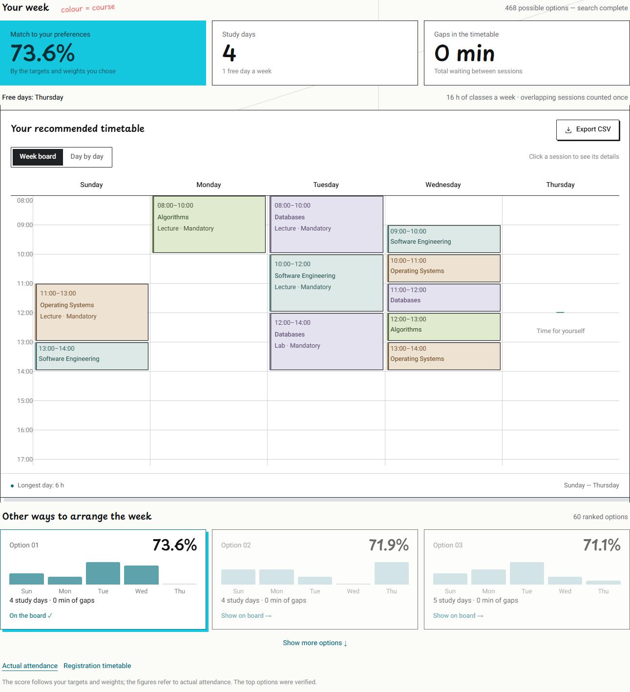

# CarpedIO – Course Schedule Optimizer

CarpedIO builds clash-free weekly university timetables. You load the course offering from Excel (or add
courses by hand), say what matters to you, such as fewer days on campus, a later start or no gaps, and
CarpedIO searches the combinations of lecture, tutorial and lab groups and ranks the best weeks.

The interface is Hebrew-first (RTL), with an English switch, light and dark themes, and a credit-weighted
GPA calculator on a second page.

[תיעוד בעברית (Hebrew README)](README.he.md)



## Features

- **Course input:** import an XLSX file or add courses by hand. Courses can have lectures, tutorials and labs,
  and each group can meet several times a week.
- **Preferences:** five weighted goals plus three presets (fewer trips, easy mornings, in the flow), a preferred
  start time, blocked times, mandatory attendance and full groups.
- **Ranked results:** up to 60 alternatives by default, each with its score, study days, gaps and weekly hours.
  Switch between a week board and a day-by-day view, open any session for details, and export to CSV.
- **Responsive search:** searches run as background jobs that report partial results and can be cancelled
  or extended with a bigger budget.
- **GPA calculator:** credit-weighted average, Excel import with column mapping, what-if simulations for future
  courses, the grade needed to reach a target, and XLSX export.
- **Interface:** Hebrew/English switch on the same page, light and dark modes, reduced-motion support and a
  layout that works on narrow screens.

## How the search engine works

- **Bitmask encoding.** The week has 14 fixed daily slots over 5 days, so a whole week is a 70-bit mask and a
  clash check is a single bitwise AND. Input whose times do not fit the slots is not rounded; it switches to
  an exact minute-level encoding (1,440 bits per day).
- **Constraint search.** Each course component (lecture, tutorial or lab) is a variable and its groups are the
  values, so the full product of groups is never generated up front. The search uses arc consistency, picks
  the most constrained component first (MRV) and prunes branches with safe cost bounds.
- **Top-K results.** The best weeks are kept in a heap. Scores come from fixed targets and weights, so a week's
  score does not depend on which other weeks were found.
- **Bounded work.** Time, work-unit and cache budgets keep every search bounded. The interface tells apart a
  proven best result, a partial result after the budget ran out, and a proof that no valid timetable exists.

More detail (in Hebrew): [docs/BITMASK_ENGINE.md](docs/BITMASK_ENGINE.md).

## Architecture

```text
web/ (HTML, CSS, vanilla JavaScript)
  │  JSON over HTTP
  ▼
web_server.py   ThreadingHTTPServer, allowlisted static paths, background search jobs
  │
  ▼
src/            Excel parsing (pandas, openpyxl), models, bitmask encoding, search, scoring
```

| Path | Role |
| --- | --- |
| `web_server.py` | Local HTTP server and JSON API; runs searches in background threads with progress and cancellation |
| `src/bitmasks.py` | Slot grid and session and week bitmask encoding |
| `src/search_model.py` | Immutable search snapshots, limits, cancellation and a bounded preparation cache |
| `src/search.py` | Exact top-K search with arc consistency, MRV and cost bounds |
| `src/scoring.py` | Target-based scoring of a week |
| `src/course_parser.py`, `src/data_loader.py` | Excel parsing and input validation |
| `src/grades_io.py` | XLSX import and export for the GPA calculator |
| `src/solver.py` | Small exhaustive reference solver used to check the main search |
| `web/scripts/` | UI state, API client, planner views, GPA math and the Hebrew/English layer |
| `tests/` | 41 Python tests (unittest) and 27 JavaScript tests (Node.js test runner) |

## Running locally

Requires Python 3.10 or later.

```bash
python -m pip install -r requirements.txt
python -B web_server.py
```

Then open <http://127.0.0.1:8000>. Use `--port 8080` to pick another port. On Windows you can also
double-click `start.bat`, which finds Python, starts the server in the background and opens the browser.

The server listens on the local machine only and is not meant for public deployment. Uploaded files are
kept in memory and are not written to disk.

## Tests

```bash
python -B -m unittest discover -s tests -p "test_*.py" -v
node --test tests/*.test.mjs
```

Node.js is only needed for the JavaScript tests.

## Excel format

Each row is one weekly session of a group. Required columns:

`CourseID, Name, Credits, Type, Group, Lecturer, Day, Start, End, Mandatory, Priority`

- `Type`: `lecture`, `tutorial` or `lab`
- `Day`: `Sunday` to `Thursday` (Hebrew day names also work)
- `Start` / `End`: `HH:MM` on the same day
- `Mandatory`: yes/no, true/false or כן/לא
- `Priority`: `low`, `medium` or `high`

A sample file is in [`data/courses_sample.xlsx`](data/courses_sample.xlsx).

## Limits

- Files up to 5 MB (25 MB after unpacking), up to 40 courses, 5,000 groups and 20,000 sessions.
- Default search budget: 60 alternatives, 15 seconds and 500,000 work units. A longer search can be requested.
- The server keeps up to 16 uploaded datasets in memory, for up to two hours each.

## Author

Eyal Hirsch, Software Engineering student at Braude College of Engineering.
[LinkedIn](https://www.linkedin.com/in/hirsch-eyal/)
